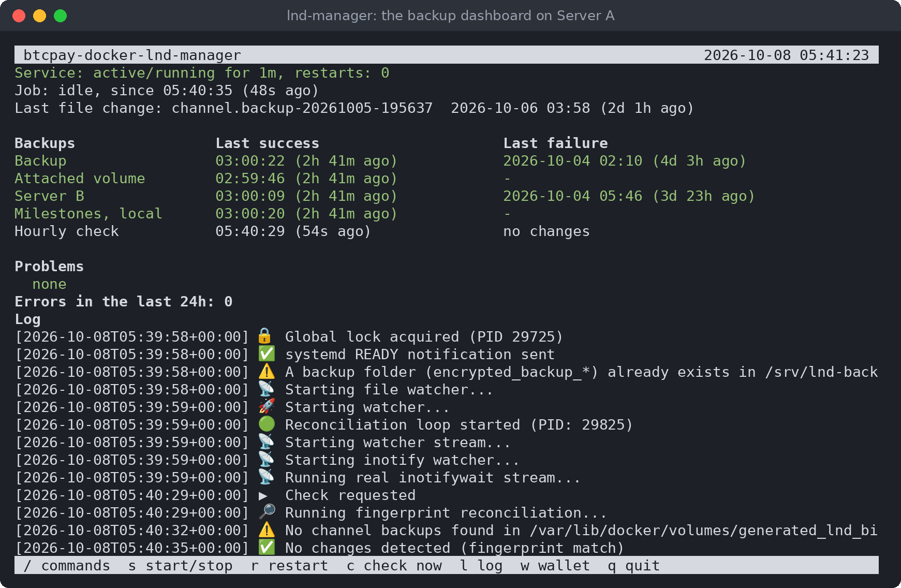
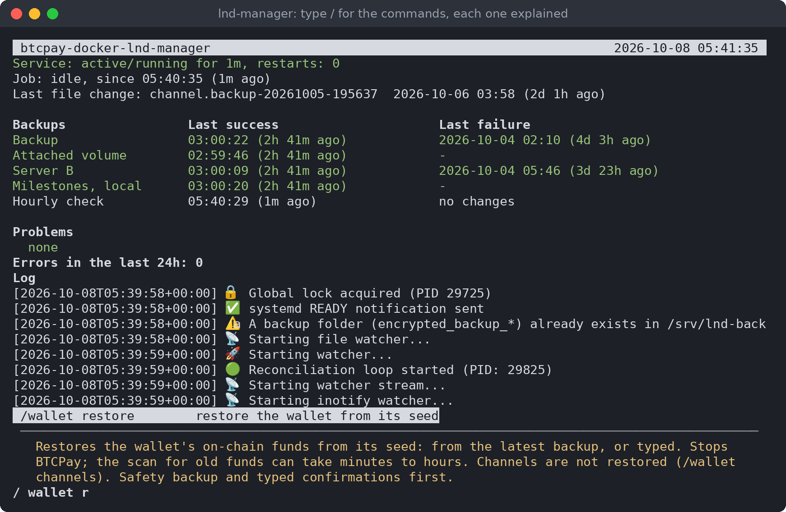
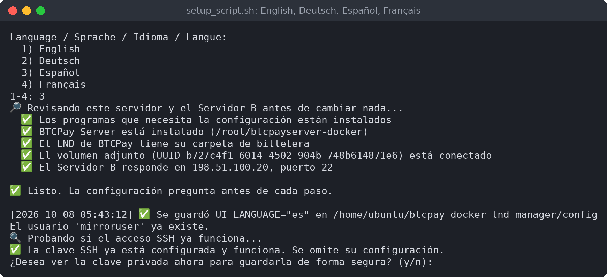
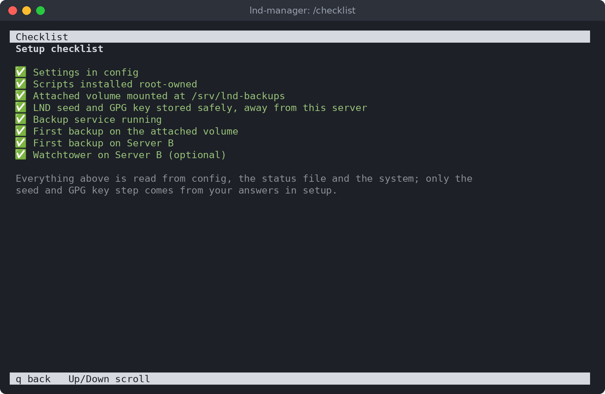
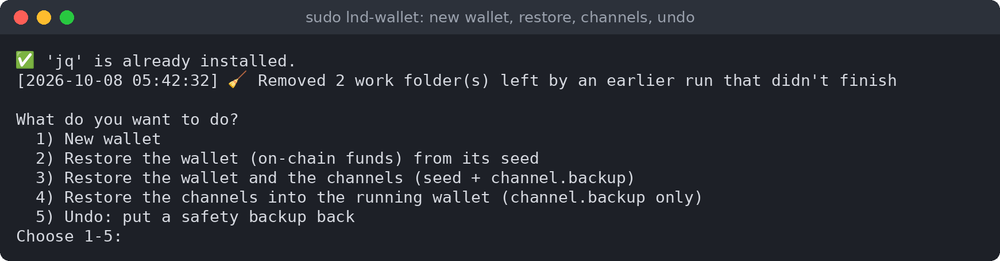
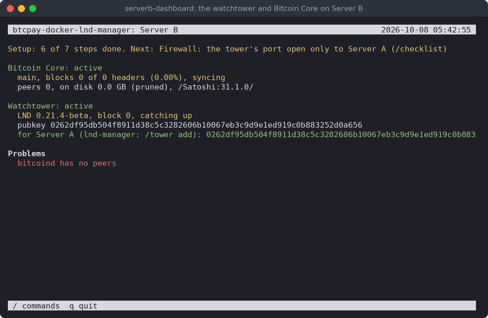

<p align="center">
  
</p>

<h1 align="center">btcpay-docker-lnd-manager</h1>

<p align="center">
  <b>Sichere, automatische Backups für den Lightning-Node Ihres BTCPay Servers, und die Werkzeuge, um ihn zurückzuholen.</b>
</p>

<p align="center">
  <a href="README.md">English</a> · <a href="README.es.md">Español</a> · <a href="README.fr.md">Français</a> · <b>Deutsch</b>
</p>

---

Backups für den Lightning-Node (LND) eines mit btcpayserver-docker installierten BTCPay Server,
dazu Werkzeuge zum Wiederherstellen der Wallet und, wenn Sie möchten, ein Watchtower auf einem
zweiten Server.

## So funktioniert es

Es gibt drei Teile:

- **Server A**: Ihr BTCPay-Server, auf dem LND läuft.
- **Das angehängte Volume**: eine zusätzliche Festplatte an Server A, nur für Backups.
- **Server B**: ein zweiter Server an einem anderen Ort.

Ein Backup-Dienst auf Server A überwacht das Kanal-Backup von LND. Nach jeder Änderung erstellt er
eine verschlüsselte, mit Ihrem GPG-Schlüssel signierte Kopie. Die Kopien gehen an die Ziele, die
Sie wählen: das angehängte Volume, Server B und ein privates GitHub-Repository, jedes ein- oder
ausgeschaltet.

Der Schlüssel von Server A kann auf Server B nur Backups ablegen, auflisten und abrufen und Server B
seine Einstellungen übergeben. Er kann
sich dort nicht anmelden und nichts anderes ausführen, daher kann ein Einbruch auf Server A nicht
löschen, was Server B aufbewahrt.

## Bildschirmfotos

Das Backup-Dashboard auf Server A, `lnd-manager`:



Tippen Sie `/` für die Befehle; jeder erklärt, was er tut und was er stoppt, bevor er läuft:




Zuerst wählen Sie die Sprache:



Die Checkliste zeigt, was erledigt ist und was noch fehlt:



Die Wallet-Werkzeuge:



Das Dashboard auf Server B:



## Bevor Sie beginnen

- **Server A**: Ubuntu oder Debian, mit BTCPay auf dem üblichen Weg installiert (btcpayserver-docker)
  und Lightning (LND) in BTCPay eingerichtet. Sie brauchen ein Konto mit sudo.
- **Eine zusätzliche Festplatte an Server A**: ein Block-Volume Ihres Anbieters oder eine zweite
  Festplatte. Nicht die Systemfestplatte. Das Setup zeigt, wie Sie sie vorbereiten, wenn sie neu ist.
- **Server B**: ein beliebiger Ubuntu- oder Debian-Server, den Sie per SSH erreichen.
- **Ihr LND-Seed, aufgeschrieben.** In BTCPay: Server Settings → Services → LND Seed Backup.

## Installation auf Server A

1. Holen Sie das Projekt auf Server A, in Ihren Home-Ordner:

   ```
   git clone https://github.com/juantrejo-coding/btcpay-docker-lnd-manager.git ~/btcpay-docker-lnd-manager
   ```

   Prüfen Sie danach seine Signatur (siehe
   [Prüfen Sie, was Sie herunterladen](#prüfen-sie-was-sie-herunterladen)): root führt diese
   Skripte aus.
2. Prüfen Sie, ob alles bereit ist. Dabei wird nichts geändert:

   ```
   cd ~/btcpay-docker-lnd-manager
   ./setup_script.sh --check
   ```

   Zeilen mit ❌ sagen, was Sie zuerst beheben müssen. Zeilen mit ⚠️ sind Dinge, die das Setup
   erledigt oder die warten können.
3. Starten Sie das Setup als Sie selbst (nicht mit sudo):

   ```
   ./setup_script.sh
   ```

   Es fragt zuerst nach der Sprache: Wählen Sie Deutsch. Dann führt es dieselbe Prüfung aus,
   fragt eine Sache nach der anderen und speichert Ihre Antworten in `config`. Es umfasst:
   - **Den Backup-Benutzer**, ein eigenes Konto, das die Backup-Arbeit erledigt. Das Setup legt
     es an.
   - **Wohin die Backups gehen**: das angehängte Volume, Server B und GitHub, jedes ein- oder
     ausgeschaltet (siehe [Wohin die Backups gehen](#wohin-die-backups-gehen)). Die folgenden
     Schritte gelten nur für die eingeschalteten.
   - **Das angehängte Volume**. Wählen Sie die Festplatte aus der Liste; das Setup hängt sie
     sicher ein.
   - **Server B**: seine Adresse, sein SSH-Port und der Benutzer, der die Backups aufbewahrt.
     Danach zeigt das Setup den Fingerabdruck von Server B. **Prüfen Sie ihn auf Server B selbst**
     (das Setup zeigt den Befehl), damit Sie wissen, dass Sie mit dem richtigen Server verbunden
     sind.
   - **Den SSH-Schlüssel**, mit dem Server A Server B erreicht. Das Setup erstellt ihn.
   - **Den GPG-Schlüssel**, der die Backups verschlüsselt. Fügen Sie einen vorhandenen ein, oder
     lassen Sie das Setup einen erstellen. **Bewahren Sie den privaten Schlüssel an einem sicheren
     Ort auf, getrennt von diesem Server: Ohne ihn kann niemand die Backups öffnen.**
   - Die Bestätigung, dass Ihr LND-Seed aufgeschrieben ist.
   - **Den Backup-Dienst**, die letzte Frage. Antworten Sie `y`.

   Die Wörter, die Sie zur Bestätigung eingeben (etwa `yes`, `STOP BTCPAY` oder
   `I WROTE IT DOWN`), sind in allen Sprachen gleich: Geben Sie sie genau so ein, wie sie
   angezeigt werden.
4. Bringen Sie den Schlüssel von Server A auf Server B. Das Setup bietet zwei Wege:
   1. Der Benutzer auf Server B existiert und Sie kennen sein Passwort: Das Setup kopiert den
      Schlüssel selbst.
   2. Andernfalls erstellt das Setup `serverb-user-setup.sh`. Kopieren Sie es selbst auf Server B,
      führen Sie es dort mit `sudo bash serverb-user-setup.sh` aus und starten Sie danach
      `./setup_script.sh` auf Server A erneut.

      Oder, wenn Sie das Projekt auch auf Server B klonen: Führen Sie `lnd-manager` →
      `/serverb send` aus. Es kann Server B noch nicht erreichen und zeigt stattdessen
      `serverb.conf` an. Führen Sie auf Server B im Klon `sudo ./serverb-setup.sh --paste` aus,
      fügen Sie es ein und antworten Sie nur bei Schritt 1 mit `yes`.

   In beiden Fällen beschränkt das Setup den Schlüssel danach so, dass er nur die Backups erreicht
   („das Gate“).
5. Öffnen Sie das Dashboard:

   ```
   lnd-manager
   ```

   Solange nicht alles eingerichtet ist, sagt die oberste Zeile, was als Nächstes zu tun ist.
   Geben Sie `/checklist` ein, um alle Schritte zu sehen.

## Im Alltag

`lnd-manager` zeigt, ob der Dienst läuft, wann das letzte Backup an jedem Ort angekommen ist, und
etwaige Probleme. Geben Sie `/` ein, um die Liste der Befehle zu sehen. Jeder Befehl erklärt, was
er tut, bevor er ausgeführt wird.

Backups werden nur erstellt, wenn sich das Kanal-Backup von LND ändert (zum Beispiel, wenn ein
Kanal geöffnet oder geschlossen wird). Tage ohne neues Backup sind bei einem ruhigen Node normal.

## Wohin die Backups gehen

Jedes Backup geht an jedes eingeschaltete Ziel. Sie schalten sie im Dashboard ein und aus:
`/destinations` zeigt sie an, `/destination volume`, `/destination serverb` und `/destination github`
schalten eines ein oder aus. Mindestens eines bleibt eingeschaltet, und das Dashboard warnt, solange
keine Kopie Server A verlässt.

| Ziel | Was es ist | Kann ein Einbruch auf Server A die Kopien dort löschen? |
|---|---|---|
| **Das angehängte Volume** | Eine zusätzliche Festplatte an Server A. Daraus lässt sich am schnellsten wiederherstellen. | Ja: Es liegt auf Server A. |
| **Server B** | Ihr zweiter Server, über sein Backup-Gate. | Nein: Das Gate löscht und überschreibt nie. |
| **GitHub** | Ein privates Repository von Ihnen. Kostenlos. | Ja: GitHub kann das bei einem kostenlosen privaten Repository nicht verhindern. |

Jedes Ziel behält die 10 neuesten Backups, 30 Tage lang das erste jedes Tages und 12 Monate lang das
erste jedes Monats, dazu die Sicherheitskopien, die `lnd-wallet` anlegt. Wenn Sie ein Ziel
ausschalten, bleiben die Kopien dort erhalten, und die Wiederherstellung sucht weiterhin überall.
Ein Ziel, bei dem etwas fehlschlägt, wird jede Stunde erneut versucht.

**GitHub**, Schritt für Schritt:
1. Legen Sie auf github.com ein neues Repository nur für die Backups an, zum Beispiel `lnd-backups`.
   Es muss **privat** und leer sein. Nicht das Repository dieses Projekts.
2. Schalten Sie GitHub ein (`/destination github`, oder antworten Sie im Setup mit Ja) und geben Sie
   das Repository als `owner/name` ein. Das Setup prüft, dass es nicht öffentlich ist.
3. Das Setup erstellt einen **Deploy-Key** für den Backup-Benutzer und zeigt ihn an: einen
   SSH-Schlüssel, der nur dieses eine Repository erreicht. Öffnen Sie auf GitHub im Repository
   **Settings → Deploy keys → Add deploy key**, fügen Sie ihn ein und setzen Sie den Haken bei
   **Allow write access**. Weder ein GitHub-Passwort noch ein Konto-Token kommt auf den Server.
4. Das Setup prüft, ob der Schlüssel schreiben kann; danach sendet der Backup-Dienst jedes Backup
   dorthin.

Das Repository behält nur die aktuellen Backups: Jeder Upload ersetzt seine Historie, daher bleibt
es klein (GitHub bittet darum, dass Repositories unter 1 GB bleiben). Alte Backups können auf
GitHubs Seite noch eine Weile liegen bleiben. Die Backups sind mit Ihrem GPG-Schlüssel verschlüsselt,
daher kann GitHub sie nicht lesen; legen Sie diesen Schlüssel nicht auf GitHub ab. GitHub sieht aber,
wann jedes Backup erstellt wurde, also wann sich Ihre Kanäle geändert haben.

Der Schlüssel muss ein **Deploy-Key** dieses einen Repositorys sein, nie ein Schlüssel Ihres
GitHub-Kontos (der alle Ihre Repositorys erreichen würde): Setup und Backup-Dienst lehnen einen
Kontoschlüssel ab.

## Wenn Sie die Wallet verlieren

```
sudo lnd-wallet restore      # das On-Chain-Guthaben, aus dem Seed
sudo lnd-wallet channels     # das Guthaben und die Kanäle
```

Oder verwenden Sie `/wallet` im Dashboard. Das Skript sucht das neueste gültige Backup auf dem
angehängten Volume, auf Server B und auf GitHub und legt eine Sicherheitskopie der aktuellen Wallet an,
bevor es etwas ändert. Server B behält bis zu 20 Sicherheitskopien (50 GB); ist er voll, löschen Sie dort
die alten. Beim Wiederherstellen der Kanäle wird jeder Peer gebeten, seinen Kanal zu schließen, und Ihr
Anteil kommt on-chain zurück. Lassen Sie nie einen wiederhergestellten Node laufen, solange der alte mit
demselben Seed noch läuft.

Ein älteres Channel-Backup ist nie gefährlich, nur unvollständig: Ein danach geöffneter Kanal bleibt
beim Peer, bis dieser ihn schließt. Deshalb:
- fragt das Skript, bevor es weitermacht, wenn ein eingeschaltetes Ziel nicht durchsucht werden kann (es
  kann das neueste Backup haben), und sagt, wenn das verwendete Backup älter ist als das neueste gefundene;
- stellt es die Kanäle aus jedem Channel-Backup wieder her, das sich mit Ihrer Wallet öffnen lässt, dem
  des Backups und dem eigenen dieses Servers, sodass jeder Kanal zurückkommt, der in einem davon ist;
- listet es danach die wiederhergestellten Kanäle auf, mit einem Link zu Ihrem Node in einem
  öffentlichen Explorer: Ein öffentlicher Kanal dort, der nicht in der Liste steht, wurde nach dem
  neuesten Backup geöffnet, und sein Peer muss ihn schließen (LND selbst sieht diese Kanäle nicht).

Rückgängig (`/wallet`, Option 5) ist etwas anderes: Es spielt das ganze LND so zurück, wie es war,
einschließlich des Kanalzustands, und ein alter Kanalzustand kann das Guthaben dieser Kanäle kosten. Es
verweigert das, wenn Ihr Node seit der Sicherheitskopie gelaufen ist, außer Sie tippen ein, dass Sie
dieses Risiko annehmen.

Das Dashboard warnt, wenn Server B ein Backup hat, das dieser Server nicht gesendet hat: ein Zeichen, dass
irgendwo ein anderes LND mit demselben Seed läuft. Stoppen Sie es sofort. Prüfen Sie jeden Server, auf
dem dieser Node je lief (ein alter, eine Kopie, ein Testrechner). Erst wenn Sie wissen, dass keiner
davon läuft, akzeptiert `/foreign ok` dieses eine Backup und die Warnung verschwindet; ein neueres von
anderswo warnt erneut.

## Optional: ein Watchtower auf Server B

Ein Watchtower behält Ihre Kanäle im Auge, während Ihr Node offline ist.

1. Im Dashboard: `/serverb send`. Es sendet Server B seine Einstellungen (`serverb.conf`) über
   das Backup-Gate in `~/serverb-setup` des Backup-Benutzers. Dort wird nichts von selbst
   ausgeführt. Wählen Sie, wie Server B die Skripte bekommt:
   1. **git clone (empfohlen).** Nur die Einstellungen kommen von Server A. Auf Server B, mit
      Ihrem Admin-Konto:

      ```
      git clone https://github.com/juantrejo-coding/btcpay-docker-lnd-manager.git
      cd btcpay-docker-lnd-manager
      ```

      Prüfen Sie die Signatur
      ([Prüfen Sie, was Sie herunterladen](#prüfen-sie-was-sie-herunterladen)), dann:

      ```
      sudo ./serverb-setup.sh <backup user>
      ```

      Es liest `serverb.conf` als Daten (führt sie nie aus), zeigt jeden Wert an und erstellt die
      Skripte aus dem Klon, den Sie geprüft haben. Root auf Server B führt dann nur Code aus, den
      Sie geprüft haben, selbst wenn auf Server A eingebrochen wurde.
   2. **Skripte von Server A.** Für einen Server B, der GitHub nicht erreicht. Server A sendet
      zusätzlich `serverb-install.sh`, alle Skripte in einer Datei. Kopieren Sie sie auf Server B
      zuerst aus dem Ordner des Backup-Benutzers heraus (root führt sie von dort nicht aus) und
      vergleichen Sie ihre sha256 mit der, die `/serverb send` angezeigt hat:

      ```
      sudo -u <backup user> cat ~<backup user>/serverb-setup/serverb-install.sh > serverb-install.sh
      sha256sum serverb-install.sh
      sudo bash serverb-install.sh
      ```

      Das ist genauso sicher, wie die Skripte von Hand zu kopieren, und nicht sicherer: Root auf
      Server B führt aus, was Server A erstellt hat. Wenn auf Server A eingebrochen wurde, kann
      auch die angezeigte sha256 gefälscht sein.

   In beiden Fällen geht es die Schritte der Reihe nach durch und fragt vor jedem: der
   Backup-Benutzer und das Gate, Bitcoin Core, der Import der Blockchain, der Watchtower, das
   Dashboard. Die ausgeführten Skripte bleiben in `/var/lib/serverb-setup/scripts`. Ein
   Backup-Gate, das älter als `/serverb send` ist, lehnt die Einstellungen ab: Verwenden Sie dann
   Weg 1 mit `--paste` (es zeigt die einzufügenden Einstellungen), und Schritt 1 aktualisiert das
   Gate.
2. Um Server B tagelanges Synchronisieren zu ersparen, kopieren Sie die Blockchain von Server A:
   `/chain copy` (vorher `/chain prune`, falls die Blockchain von BTCPay noch nicht gepruned ist).
   Es fragt, wo die Blockchain auf die Größe von Server B gepruned wird: auf Server A, in einer Kopie
   neben der von BTCPay (die Blockchain von BTCPay bleibt unverändert, und es wird etwa halb so viel
   gesendet: der Chainstate, rund 12 GB, lässt sich nicht prunen), oder auf Server B nach dem Import.
   Vorher prüft es, ob beide Server genug Platz haben.
   Die Schritte halten nach Bitcoin Core an, bis die Kopie fertig ist; führen Sie danach denselben
   Befehl auf Server B erneut aus, um fortzufahren.
3. Wieder auf Server A: `/tower add`, mit der Adresse des Towers, die der Watchtower-Schritt
   angezeigt hat.

`/serverb scripts` erstellt weiterhin die Skripte einzeln, damit Sie sie selbst auf Server B
kopieren.

Melden Sie sich auf Server B mit dem Admin-Konto des Dashboards an und starten Sie
`serverb-dashboard`. Es hat eine eigene `/checklist` und meldet, wenn eine neue Version von
Bitcoin Core, LND oder diesen Skripten erschienen ist (siehe [Aktualisieren](#aktualisieren)).

## Sicher und offline aufbewahren

- **Ihren LND-Seed.** Er bringt Ihr Guthaben zurück.
- **Den privaten GPG-Schlüssel.** Er öffnet die Backups.

## Prüfen Sie, was Sie herunterladen

Jeder Commit und jedes Release-Tag ist mit diesem GPG-Schlüssel signiert:

```
Juan Trejo <juantrejo_coding@proton.me>
93F4 433D CE56 353B D7E6  9D42 CBFE 4123 CF41 21FA
```

Ein Fingerabdruck, der neben dem Code steht, beweist für sich allein nichts: Wer den Code ändern
könnte, könnte auch diese Seite ändern. Holen Sie den Schlüssel deshalb von zwei Orten und prüfen
Sie, dass beide den obigen Fingerabdruck zeigen:

```
curl -fsSL https://github.com/juantrejo-coding.gpg | gpg --show-keys
gpg --keyserver hkps://keys.openpgp.org --recv-keys 93F4433DCE56353BD7E69D42CBFE4123CF4121FA
gpg --fingerprint 93F4433DCE56353BD7E69D42CBFE4123CF4121FA
```

Dann, im Klon:

```
git tag -l                           # the releases
git verify-tag <newest tag>          # "Good signature from Juan Trejo", with the fingerprint above
git checkout <newest tag>
git log --show-signature -3          # each commit: "Good signature", the same fingerprint
```

Solange es noch kein Release-Tag gibt, prüfen Sie stattdessen den neuesten Commit:
`git verify-commit HEAD`. gpg fügt eventuell „This key is not certified with a trusted signature“
hinzu (der Schlüssel ist nicht mit einer vertrauenswürdigen Signatur beglaubigt): Das ist normal
bei einem Schlüssel, den Sie nicht selbst signiert haben. Entscheidend sind „Good signature“ (gute
Signatur) und der Fingerabdruck. Bei allem anderen (eine BAD-Signatur, ein anderer Fingerabdruck,
keine Signatur): Führen Sie es nicht aus.

Von Hand machen Sie das nur beim ersten Mal. Danach prüfen die unten beschriebenen
Update-Befehle jede neue Version auf dieselbe Weise, mit dem Schlüssel, der mit den Skripten
installiert wurde.

## Aktualisieren

Nichts wird von selbst aktualisiert. Beide Dashboards melden, wenn eine neue Version erschienen
ist; Sie starten das Update und tippen `UPDATE`. Jedes Update lädt die Version zuerst herunter und
prüft ihre Signatur, dann installiert es sie erst, wenn das sicher ist. Ist es noch nicht sicher,
wartet es im Hintergrund und prüft alle 5 Minuten, bis zu 24 Stunden lang; danach wird das Update
beim nächsten Start installiert, bevor die betroffenen Dienste starten. Das Dashboard zeigt ein
wartendes Update an.

**Server A** (`/update` in `lnd-manager` oder `sudo lnd-update`): diese Skripte, aus dem neuesten
signierten Release-Tag. Sicher heißt: Es läuft kein Backup, keine Wallet-Operation und keine
`/chain`- oder `/tower`-Operation. Der Backup-Dienst wird neu installiert; LND und BTCPay laufen
weiter (BTCPay aktualisiert sie selbst, mit `btcpay-update.sh`). Ihr Arbeitsordner wird auf
dieselbe Version gebracht, Ihre `config` bleibt erhalten. Wenn Sie dort andere Dateien geändert
haben, bleibt er unverändert, und das Update sagt es Ihnen; `install-scripts.sh` weigert sich
dann, die ältere Version wieder zu installieren.

**Server B** (`serverb-dashboard`):
- `/update scripts`: diese Skripte, aus der neuesten signierten Version, erstellt mit den
  Einstellungen, die `serverb-setup.sh` gespeichert hat. Das Backup-Gate und das Dashboard werden
  aktualisiert; bitcoind und der Watchtower laufen weiter. Setzt einen Server B voraus, der GitHub
  erreicht (Weg 1 oben); verwenden Sie sonst erneut `/serverb send`.
- `/update bitcoind` und `/update tower`: das neueste Bitcoin Core bzw. LND, geprüft wie im Setup.
  Das Update startet den Watchtower neu, deshalb geschieht es nur, während der Node von Server A
  seine eigenen Kanäle im Auge behalten kann: Server A sendet alle 5 Minuten seinen Zustand über
  das Gate (nur Daten), und das Update wartet, bis dieser Zustand weniger als 10 Minuten alt ist,
  LND dort läuft, keine Zahlung unterwegs ist und kein Kanal geöffnet oder geschlossen wird. Ein
  ausgeschalteter Server A gilt als nicht sicher: Genau dann wird der Tower gebraucht.

Später kommen diese Skripte vielleicht auch als Paket aus einem APT-Repository; dieselben Befehle
verwenden dann apt, das die Signatur des Pakets prüft.

## Einstellungen ändern

Bearbeiten Sie `config` in Ihrem Arbeitsordner und führen Sie dann dort `sudo ./install-scripts.sh`
aus. Die Skripte, die als root laufen, verwenden nur die Kopien, die es in
`/usr/local/lib/btcpay-docker-lnd-manager` installiert, sodass niemand sonst sie ändern kann. Wenn
Sie Einstellungen geändert haben, die der Backup-Dienst verwendet, führen Sie auch `/install` im
Dashboard aus.

Die Sprache ist `UI_LANGUAGE` in `config`: `en` (Englisch) oder der Code einer beliebigen
Übersetzung in `locale/` (`de` für Deutsch).

## Unterstützung

Wenn es Ihren Node schützt, unterstützen Sie bitte die Entwicklung. Bitcoin:

```
bc1qevxw36e4htzvlke3y0kqqz3qs0nfmreqhxkt73
```

Das ist auch die Spendenadresse, an die die Zahlungen der Lizenz gehen (siehe [LICENSE](LICENSE), Abschnitt 5).

## Lizenz

Siehe `LICENSE` oder `/support` im Dashboard.
