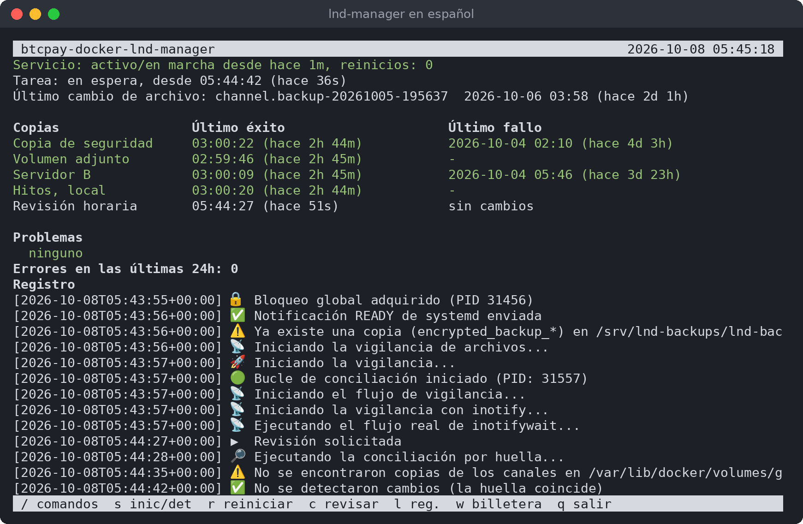

<p align="center">
  
</p>

<h1 align="center">btcpay-docker-lnd-manager</h1>

<p align="center">
  <b>Respaldos automáticos y seguros del nodo Lightning de su BTCPay Server, y las herramientas para recuperarlo.</b>
</p>

<p align="center">
  <a href="README.md">English</a> · <b>Español</b> · <a href="README.fr.md">Français</a> · <a href="README.de.md">Deutsch</a>
</p>

---

Copias de seguridad del nodo Lightning (LND) de un BTCPay Server instalado con
btcpayserver-docker, herramientas para restaurar la billetera y, si lo desea, un watchtower en un
segundo servidor.

## Cómo funciona

Hay tres partes:

- **Servidor A**: su servidor BTCPay, donde corre LND.
- **El volumen adjunto**: un disco adicional en el Servidor A, solo para las copias de seguridad.
- **Servidor B**: un segundo servidor en otro lugar.

Un servicio de copias de seguridad en el Servidor A vigila la copia de los canales de LND. Después
de cada cambio hace una copia cifrada y firmada con su clave GPG. Una copia va al volumen adjunto
y otra al Servidor B.

La clave del Servidor A solo puede guardar, listar y descargar copias en el Servidor B, y enviarle sus ajustes. No puede
iniciar sesión allí ni ejecutar nada más, así que quien entre sin permiso en el Servidor A no puede
borrar lo que guarda el Servidor B.

## Capturas de pantalla

El panel de copias de seguridad en el Servidor A, `lnd-manager`:



Escriba `/` para ver los comandos; cada uno explica qué hace, y qué detiene, antes de ejecutarse:


Primero se elige el idioma:


La lista de pasos muestra lo que ya está hecho y lo que falta:


Las herramientas de la billetera:


El panel del Servidor B:


## Antes de empezar

- **Servidor A**: Ubuntu o Debian, con BTCPay instalado de la forma habitual (btcpayserver-docker)
  y Lightning (LND) configurado en BTCPay. Necesita una cuenta con sudo.
- **Un disco adicional en el Servidor A**: un volumen de bloque de su proveedor, o un segundo
  disco. No el disco del sistema. La configuración explica cómo prepararlo si es nuevo.
- **Servidor B**: cualquier servidor Ubuntu o Debian al que llegue por SSH.
- **Su semilla de LND, anotada.** En BTCPay: Server Settings → Services → LND Seed Backup.

## Instalación en el Servidor A

1. Descargue el proyecto en el Servidor A, en su carpeta personal:

   ```
   git clone https://github.com/juantrejo-coding/btcpay-docker-lnd-manager.git ~/btcpay-docker-lnd-manager
   ```

   Después compruebe su firma (vea [Compruebe lo que descarga](#compruebe-lo-que-descarga)): root
   ejecuta estos scripts.
2. Compruebe que todo está listo. Esto no cambia nada:

   ```
   cd ~/btcpay-docker-lnd-manager
   ./setup_script.sh --check
   ```

   Las líneas con ❌ dicen qué arreglar primero. Las líneas con ⚠️ son cosas que la configuración
   resuelve, o que pueden esperar.
3. Ejecute la configuración, con su propio usuario (no con sudo):

   ```
   ./setup_script.sh
   ```

   Primero pregunta el idioma: elija Español. Luego hace la misma comprobación, pregunta
   una cosa a la vez y guarda sus respuestas en `config`. Cubre:
   - **El usuario de copias**, una cuenta aparte que hace el trabajo de las copias. La
     configuración la crea.
   - **El volumen adjunto**. Elija el disco de la lista; la configuración lo monta de forma segura.
   - **El Servidor B**: su dirección, su puerto SSH y el usuario que guardará las copias. Después
     la configuración muestra la huella del Servidor B. **Compruébela en el propio Servidor B**
     (la configuración muestra el comando), para saber que habla con el servidor correcto.
   - **La clave SSH** que usa el Servidor A para llegar al Servidor B. La configuración la crea.
   - **La clave GPG** que cifra las copias. Pegue una que ya tenga, o deje que la configuración
     cree una. **Guarde la clave privada en un lugar seguro, fuera de este servidor: sin ella
     nadie puede abrir las copias.**
   - La confirmación de que tiene anotada su semilla de LND.
   - **El servicio de copias de seguridad**, la última pregunta. Responda `y`.

   Las palabras que hay que escribir para confirmar (como `yes`, `STOP BTCPAY` o
   `I WROTE IT DOWN`) son las mismas en todos los idiomas: escríbalas tal como se muestran.
4. Lleve la clave del Servidor A al Servidor B. La configuración ofrece dos caminos:
   1. El usuario del Servidor B ya existe y usted conoce su contraseña: la configuración copia la
      clave por sí misma.
   2. Si no, la configuración crea `serverb-user-setup.sh`. Cópielo usted mismo al Servidor B y
      ejecútelo allí con `sudo bash serverb-user-setup.sh`; después vuelva a ejecutar
      `./setup_script.sh` en el Servidor A.

      O, si también descarga el proyecto con git clone en el Servidor B: ejecute `lnd-manager` →
      `/serverb send`, que aún no puede llegar al Servidor B y en su lugar muestra `serverb.conf`.
      En el Servidor B, en la copia descargada, ejecute `sudo ./serverb-setup.sh --paste`, péguelo
      y responda `yes` solo al paso 1.

   En los dos casos, la configuración limita después la clave para que solo llegue a las copias
   ("la compuerta").
5. Abra el panel:

   ```
   lnd-manager
   ```

   Mientras falte algo, la primera línea dice qué hacer a continuación. Escriba `/checklist` para
   ver todos los pasos.

## Uso diario

`lnd-manager` muestra si el servicio está en marcha, cuándo llegó la última copia a cada lugar y
cualquier problema. Escriba `/` para ver la lista de comandos. Cada uno explica qué hace antes de
ejecutarse.

Las copias solo se hacen cuando cambia la copia de los canales de LND (por ejemplo, cuando se abre
o se cierra un canal). En un nodo tranquilo es normal pasar días sin una copia nueva.

## Si pierde la billetera

```
sudo lnd-wallet restore      # los fondos on-chain, desde la semilla
sudo lnd-wallet channels     # los fondos y los canales
```

O use `/wallet` en el panel. El script busca la copia válida más reciente en el volumen adjunto o
en el Servidor B, y guarda una copia de resguardo de la billetera actual antes de cambiar nada.
El Servidor B guarda hasta 20 copias de resguardo (50 GB); cuando esté lleno, borre allí las antiguas.
Restaurar los canales le pide a cada par que cierre su canal, y su parte vuelve on-chain.

## Opcional: un watchtower en el Servidor B

Un watchtower vigila sus canales mientras su nodo está desconectado.

1. En el panel: `/serverb send`. Envía al Servidor B sus ajustes (`serverb.conf`) a través de la
   compuerta de copias, a `~/serverb-setup` del usuario de copias. Allí no se ejecuta nada por sí
   solo. Elija cómo recibe el Servidor B los scripts:
   1. **git clone (recomendado).** Del Servidor A solo vienen los ajustes. En el Servidor B, con
      su cuenta de administración:

      ```
      git clone https://github.com/juantrejo-coding/btcpay-docker-lnd-manager.git
      cd btcpay-docker-lnd-manager
      ```

      Compruebe la firma ([Compruebe lo que descarga](#compruebe-lo-que-descarga)) y luego:

      ```
      sudo ./serverb-setup.sh <backup user>
      ```

      Lee `serverb.conf` como datos (nunca lo ejecuta), muestra cada valor y crea los scripts a
      partir de la copia descargada que usted comprobó. Así root en el Servidor B solo ejecuta
      código que usted comprobó, aunque alguien haya entrado sin permiso en el Servidor A.
   2. **Scripts desde el Servidor A.** Para un Servidor B que no llega a GitHub. El Servidor A
      también envía `serverb-install.sh`, todos los scripts en un solo archivo. En el Servidor B,
      primero cópielo fuera de la carpeta del usuario de copias (root no lo ejecuta desde allí)
      y compare su sha256 con el que mostró `/serverb send`:

      ```
      sudo -u <backup user> cat ~<backup user>/serverb-setup/serverb-install.sh > serverb-install.sh
      sha256sum serverb-install.sh
      sudo bash serverb-install.sh
      ```

      Esto es tan seguro como copiar los scripts a mano, y no más: root en el Servidor B ejecuta
      lo que creó el Servidor A. Si alguien entró sin permiso en el Servidor A, también puede
      falsificar el sha256 que este muestra.

   En los dos casos recorre los pasos en orden y pregunta antes de cada uno: el usuario de copias
   y la compuerta, Bitcoin Core, la importación de la blockchain, el watchtower, el panel. Los
   scripts que ejecutó quedan en `/var/lib/serverb-setup/scripts`. Una compuerta de copias más
   antigua que `/serverb send` rechaza los ajustes: en ese caso use el camino 1 con `--paste`
   (muestra los ajustes para pegarlos), y el paso 1 actualiza la compuerta.
2. Para ahorrarle al Servidor B días de sincronización, copie la blockchain desde el Servidor A:
   `/chain copy` (antes `/chain prune`, si la blockchain de BTCPay aún no está podada). Los pasos
   se detienen después de Bitcoin Core hasta que termine la copia; vuelva a ejecutar el mismo
   comando en el Servidor B para continuar.
3. De vuelta en el Servidor A: `/tower add`, con la dirección de la torre que mostró el paso del
   watchtower.

`/serverb scripts` sigue creando los scripts uno por uno, para que usted mismo los copie al
Servidor B.

En el Servidor B, inicie sesión con la cuenta de administración del panel y ejecute
`serverb-dashboard`. Tiene su propio `/checklist` y avisa cuando sale una versión nueva de
Bitcoin Core, de LND o de estos scripts (vea [Actualizar](#actualizar)).

## Guarde esto en un lugar seguro, sin conexión

- **Su semilla de LND.** Con ella recupera sus fondos.
- **La clave privada GPG.** Con ella se abren las copias.

## Compruebe lo que descarga

Cada commit y cada etiqueta de versión están firmados con esta clave GPG:

```
Juan Trejo <juantrejo_coding@proton.me>
93F4 433D CE56 353B D7E6  9D42 CBFE 4123 CF41 21FA
```

Una huella impresa junto al código no prueba nada por sí sola: quien pudiera cambiar el código
también podría cambiar esta página. Por eso, obtenga la clave de dos lugares y compruebe que los
dos muestran la huella de arriba:

```
curl -fsSL https://github.com/juantrejo-coding.gpg | gpg --show-keys
gpg --keyserver hkps://keys.openpgp.org --recv-keys 93F4433DCE56353BD7E69D42CBFE4123CF4121FA
gpg --fingerprint 93F4433DCE56353BD7E69D42CBFE4123CF4121FA
```

Después, en la copia descargada:

```
git tag -l                           # the releases
git verify-tag <newest tag>          # "Good signature from Juan Trejo", with the fingerprint above
git checkout <newest tag>
git log --show-signature -3          # each commit: "Good signature", the same fingerprint
```

Si aún no hay una etiqueta de versión, compruebe en su lugar el commit más reciente:
`git verify-commit HEAD`. gpg puede añadir "This key is not certified with a trusted signature"
(esta clave no está certificada con una firma de confianza): es normal con una clave que usted no
ha firmado. Lo que cuenta es "Good signature" (firma válida) y la huella. Cualquier otra cosa (una
firma BAD, otra huella, ninguna firma): no lo ejecute.

Esto solo lo hace a mano la primera vez. Después, los comandos de actualización de abajo
comprueban cada versión nueva de la misma forma, con la clave que se instaló junto con los scripts.

## Actualizar

Nada se actualiza solo. Los dos paneles avisan cuando sale una versión nueva; usted inicia la
actualización y escribe `UPDATE`. Cada actualización primero descarga la versión y comprueba su
firma, y luego la instala solo cuando es seguro hacerlo. Si aún no lo es, espera en segundo plano y
lo vuelve a comprobar cada 5 minutos, durante 24 horas como máximo; pasado ese tiempo, la
actualización se instala en el siguiente arranque, antes de que se inicien los servicios a los que
afecta. El panel muestra si hay una actualización esperando.

**Servidor A** (`/update` en `lnd-manager`, o `sudo lnd-update`): estos scripts, desde la etiqueta
de versión firmada más reciente. Seguro significa que no está en curso ninguna copia de seguridad,
ninguna operación de la billetera ni ninguna operación de `/chain` o `/tower`. El servicio de
copias se reinstala; LND y BTCPay siguen funcionando (BTCPay los actualiza por su cuenta, con
`btcpay-update.sh`). Su carpeta de trabajo pasa a la misma versión y se conserva su `config`. Si
cambió otros archivos allí, la carpeta se deja como está y la actualización lo indica; entonces
`install-scripts.sh` se niega a volver a instalar la versión anterior.

**Servidor B** (`serverb-dashboard`):
- `/update scripts`: estos scripts, desde la versión firmada más reciente, creados con los ajustes
  que guardó `serverb-setup.sh`. Se actualizan la compuerta de copias y el panel; bitcoind y el
  watchtower siguen funcionando. Necesita un Servidor B que llegue a GitHub (el camino 1 de
  arriba); si no, vuelva a usar `/serverb send`.
- `/update bitcoind` y `/update tower`: la versión más reciente de Bitcoin Core o de LND,
  comprobada igual que la comprueba la configuración. Actualizar reinicia el watchtower, así que
  solo se hace mientras el nodo del Servidor A puede vigilar sus propios canales: el Servidor A
  envía su estado cada 5 minutos a través de la compuerta (solo datos), y la actualización espera
  hasta que ese estado tenga menos de 10 minutos, LND esté funcionando allí, no haya ningún pago
  en curso y no se esté abriendo ni cerrando ningún canal. Un Servidor A apagado cuenta como no
  seguro: es justo cuando se necesita la torre.

Más adelante, estos scripts también podrían llegar como paquete desde un repositorio APT; entonces
los mismos comandos usarán apt, que comprueba la firma del paquete.

## Cambiar la configuración

Edite `config` en su carpeta de trabajo y luego ejecute allí `sudo ./install-scripts.sh`. Los
scripts que corren como root solo usan las copias que este instala en
`/usr/local/lib/btcpay-docker-lnd-manager`, así nadie más puede cambiarlas. Si cambia ajustes que
usa el servicio de copias, ejecute también `/install` en el panel.

El idioma se cambia con `UI_LANGUAGE` en `config`: `en` (inglés), o el código de cualquier
traducción en `locale/` (`es` para español).

## Apoyo

Si mantiene seguro su nodo, apoye su desarrollo. Bitcoin:

```
bc1qevxw36e4htzvlke3y0kqqz3qs0nfmreqhxkt73
```

Es también la dirección de donaciones a la que van los pagos de la licencia (vea [LICENSE](LICENSE), sección 5).

## Licencia

Vea `LICENSE`, o `/support` en el panel.
