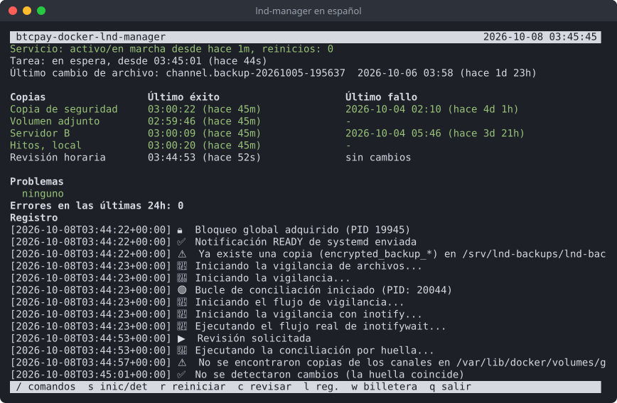
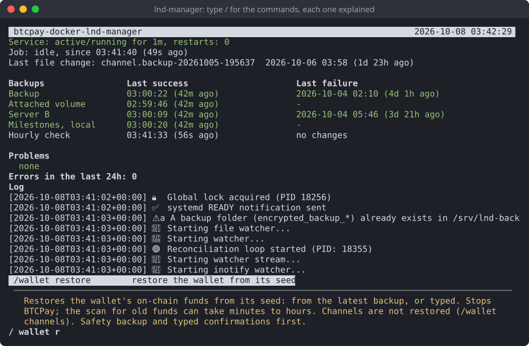
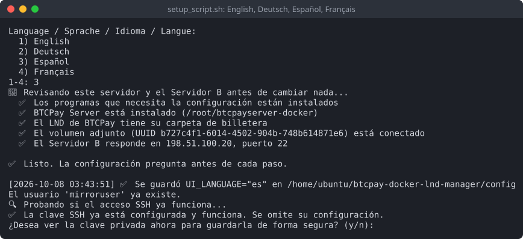
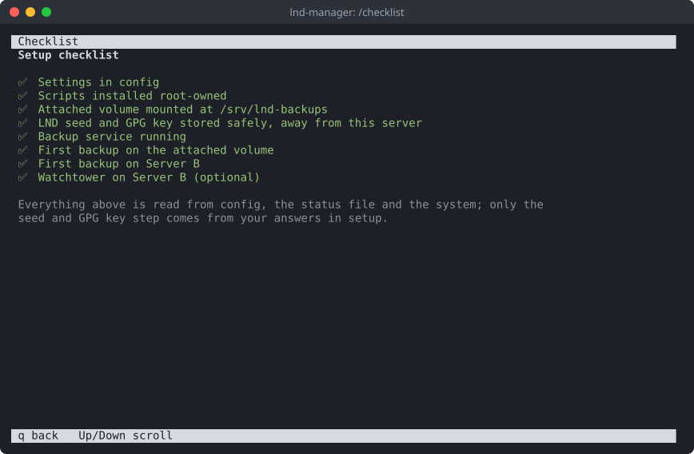
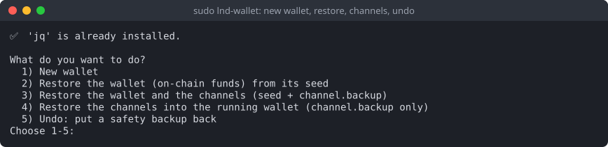
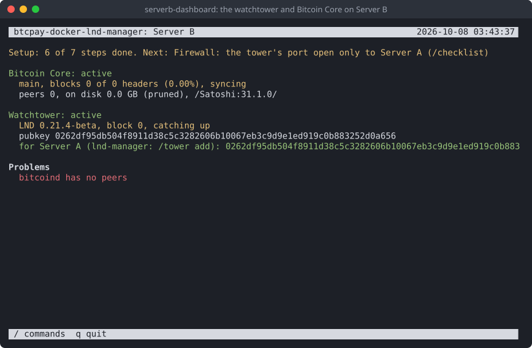

# btcpay-docker-lnd-manager

[English](README.md) · **Español** · [Français](README.fr.md) · [Deutsch](README.de.md)

Copias de seguridad del nodo Lightning (LND) de un BTCPay Server instalado con
btcpayserver-docker, herramientas para restaurar la billetera y, si lo desea, un watchtower en un
segundo servidor.

## Cómo funciona

Hay tres partes:

- **Servidor A**: su servidor BTCPay, donde corre LND.
- **El volumen adjunto**: un disco adicional en el Servidor A, solo para las copias de seguridad.
- **Servidor B**: un segundo servidor en otro lugar.

Un servicio de copias de seguridad en el Servidor A vigila la copia de los canales de LND. Después
de cada cambio hace una copia cifrada y firmada con su clave GPG. Una copia va al volumen adjunto
y otra al Servidor B.

La clave del Servidor A solo puede guardar, listar y descargar copias en el Servidor B. No puede
iniciar sesión allí ni ejecutar nada más, así que quien entre sin permiso en el Servidor A no puede
borrar lo que guarda el Servidor B.

## Capturas de pantalla

El panel de copias de seguridad en el Servidor A, `lnd-manager`:



Escriba `/` para ver los comandos; cada uno explica qué hace, y qué detiene, antes de ejecutarse:



| | |
|---|---|
|  |  |
|  |  |

## Antes de empezar

- **Servidor A**: Ubuntu o Debian, con BTCPay instalado de la forma habitual (btcpayserver-docker)
  y Lightning (LND) configurado en BTCPay. Necesita una cuenta con sudo.
- **Un disco adicional en el Servidor A**: un volumen de bloque de su proveedor, o un segundo
  disco. No el disco del sistema. La configuración explica cómo prepararlo si es nuevo.
- **Servidor B**: cualquier servidor Ubuntu o Debian al que llegue por SSH.
- **Su semilla de LND, anotada.** En BTCPay: Server Settings → Services → LND Seed Backup.

## Instalación en el Servidor A

1. Copie esta carpeta al Servidor A, en su carpeta personal: `~/btcpay-docker-lnd-manager`.
2. Compruebe que todo está listo. Esto no cambia nada:

   ```
   cd ~/btcpay-docker-lnd-manager
   ./setup_script.sh --check
   ```

   Las líneas con ❌ dicen qué arreglar primero. Las líneas con ⚠️ son cosas que la configuración
   resuelve, o que pueden esperar.
3. Ejecute la configuración, con su propio usuario (no con sudo):

   ```
   ./setup_script.sh
   ```

   Primero pregunta el idioma: elija Español. Luego hace la misma comprobación, pregunta
   una cosa a la vez y guarda sus respuestas en `config`. Cubre:
   - **El usuario de copias**, una cuenta aparte que hace el trabajo de las copias. La
     configuración la crea.
   - **El volumen adjunto**. Elija el disco de la lista; la configuración lo monta de forma segura.
   - **El Servidor B**: su dirección, su puerto SSH y el usuario que guardará las copias. Después
     la configuración muestra la huella del Servidor B. **Compruébela en el propio Servidor B**
     (la configuración muestra el comando), para saber que habla con el servidor correcto.
   - **La clave SSH** que usa el Servidor A para llegar al Servidor B. La configuración la crea.
   - **La clave GPG** que cifra las copias. Pegue una que ya tenga, o deje que la configuración
     cree una. **Guarde la clave privada en un lugar seguro, fuera de este servidor: sin ella
     nadie puede abrir las copias.**
   - La confirmación de que tiene anotada su semilla de LND.
   - **El servicio de copias de seguridad**, la última pregunta. Responda `y`.

   Las palabras que hay que escribir para confirmar (como `yes`, `STOP BTCPAY` o
   `I WROTE IT DOWN`) son las mismas en todos los idiomas: escríbalas tal como se muestran.
4. Lleve la clave del Servidor A al Servidor B. La configuración ofrece dos caminos:
   1. El usuario del Servidor B ya existe y usted conoce su contraseña: la configuración copia la
      clave por sí misma.
   2. Si no, la configuración crea `serverb-user-setup.sh`. Cópielo usted mismo al Servidor B y
      ejecútelo allí con `sudo bash serverb-user-setup.sh`; después vuelva a ejecutar
      `./setup_script.sh` en el Servidor A.

   En los dos casos, la configuración limita después la clave para que solo llegue a las copias
   ("la compuerta").
5. Abra el panel:

   ```
   lnd-manager
   ```

   Mientras falte algo, la primera línea dice qué hacer a continuación. Escriba `/checklist` para
   ver todos los pasos.

## Uso diario

`lnd-manager` muestra si el servicio está en marcha, cuándo llegó la última copia a cada lugar y
cualquier problema. Escriba `/` para ver la lista de comandos. Cada uno explica qué hace antes de
ejecutarse.

Las copias solo se hacen cuando cambia la copia de los canales de LND (por ejemplo, cuando se abre
o se cierra un canal). En un nodo tranquilo es normal pasar días sin una copia nueva.

## Si pierde la billetera

```
sudo lnd-wallet restore      # los fondos on-chain, desde la semilla
sudo lnd-wallet channels     # los fondos y los canales
```

O use `/wallet` en el panel. El script busca la copia válida más reciente en el volumen adjunto o
en el Servidor B, y guarda una copia de resguardo de la billetera actual antes de cambiar nada.
Restaurar los canales le pide a cada par que cierre su canal, y su parte vuelve on-chain.

## Opcional: un watchtower en el Servidor B

Un watchtower vigila sus canales mientras su nodo está desconectado.

1. En el panel: `/serverb scripts`. Crea los scripts del Servidor B y lista los pasos en orden.
2. Copie usted mismo los scripts al Servidor B, desde una computadora de confianza, y ejecútelos
   allí con `sudo bash`: primero Bitcoin Core, luego el watchtower, luego el panel del Servidor B.
3. Para ahorrarle al Servidor B días de sincronización, copie la blockchain desde el Servidor A:
   `/chain copy` (antes `/chain prune`, si la blockchain de BTCPay aún no está podada), y luego
   `serverb-import-chain.sh` en el Servidor B.
4. De vuelta en el Servidor A: `/tower add`.

En el Servidor B, inicie sesión con la cuenta de administración del panel y ejecute
`serverb-dashboard`. Tiene su propio `/checklist`. También avisa cuando sale una versión nueva de
Bitcoin Core o de LND: `/update bitcoind` o `/update tower` la instala, después de comprobar sus
firmas igual que lo hizo la configuración. Nada se actualiza solo.

## Guarde esto en un lugar seguro, sin conexión

- **Su semilla de LND.** Con ella recupera sus fondos.
- **La clave privada GPG.** Con ella se abren las copias.

## Cambiar la configuración o actualizar

Edite `config` en su carpeta de trabajo y luego ejecute allí `sudo ./install-scripts.sh`. Los
scripts que corren como root solo usan las copias que este instala en
`/usr/local/lib/btcpay-docker-lnd-manager`, así nadie más puede cambiarlas. Después de actualizar
los scripts, ejecute también `/install` en el panel para actualizar el servicio de copias.

El idioma se cambia con `UI_LANGUAGE` en `config`: `en` (inglés), o el código de cualquier
traducción en `locale/` (`es` para español).

## Licencia

Vea `LICENSE`, o `/support` en el panel.
