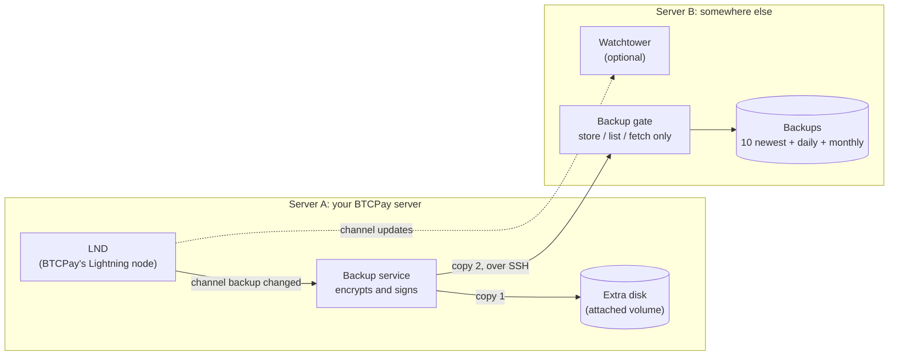

<p align="center">
  
</p>

<h1 align="center">btcpay-docker-lnd-manager</h1>

<p align="center">
  <b>Safe, automatic backups for the Lightning node of your BTCPay Server, and the tools to get it back.</b>
</p>

<p align="center">
  <b>English</b> · <a href="README.es.md">Español</a> · <a href="README.fr.md">Français</a> · <a href="README.de.md">Deutsch</a>
</p>

---

If your BTCPay Server's disk dies, the Lightning funds on it are only as safe as your last
backup of the node. btcpay-docker-lnd-manager makes those backups by itself, every time they
are needed, keeps them in two places, and walks you through getting your wallet and channels
back. It runs next to a BTCPay Server installed the usual way (btcpayserver-docker), with LND.

## What it does

- **Backs up LND by itself.** A service watches LND's channel backup. Each time it changes (a
  channel opens or closes), and once an hour in any case, it makes a new backup.
- **Encrypted, signed, in two places.** Every backup is encrypted and signed with your GPG key,
  then stored on an extra disk on the server and on a second server. The copy on the second
  server is checked after it arrives.
- **The second server is protected from the first.** The first server's key can only store,
  list and fetch backups there: no shell, no deleting, no overwriting. A break-in on your BTCPay
  server can't wipe the backups somewhere else.
- **Gets your wallet back.** `lnd-wallet` restores the wallet from its seed, the channels from
  the newest good backup, or makes a new wallet. It always keeps a copy of the current wallet
  first, so every step can be undone.
- **A dashboard on each server.** It shows what's working, when the last backup reached each
  place, what's wrong, and what to do next. Type `/` for the commands: each one says what it
  does, and what it stops, before it runs.
- **Optional watchtower.** The second server can run Bitcoin Core and an LND watchtower that
  guards your channels while your node is offline. The blockchain can be copied over instead of
  downloaded for days, and new Bitcoin Core and LND releases are installed only after their
  signatures check out.
- **Four languages:** English, Spanish, French and German, for every screen, question and the
  backup log.

## How it works



- **Server A** is your BTCPay server. The backup service runs there as an account of its own,
  not as root. The scripts root runs are installed so that only root can change them.
- **The attached volume** is an extra disk on Server A, used only for backups.
- **Server B** is a second server you control, anywhere else. Its "gate" is the only thing
  Server A's key may run there. Server B keeps the 10 newest backups, one a day for 30 days,
  and one a month for 12 months, and rotates them itself.
- **To restore,** `lnd-wallet` looks on both places for the newest backup that decrypts, is
  signed with your key and matches its checksum, and tells you which one it found before
  anything changes.

## Screenshots

The backup dashboard on Server A:


Type `/` for the commands. Each one is explained before it runs:


| Before anything changes, setup checks the server | The checklist shows what's done and what's next |
|---|---|
|  |  |
| **The wallet tools** | **The dashboard on Server B** |
|  |  |
| **Setup asks for the language first** | **Everything in that language, the log too** |
|  |  |

## Before you start

- **Server A**: Ubuntu or Debian (Raspberry Pi OS too), with BTCPay installed the usual way
  (btcpayserver-docker) and Lightning (LND) set up in BTCPay. You need an account with sudo.
- **An extra disk on Server A**: a block volume from your provider, or a second disk. Not the
  system disk. Setup shows how to prepare it if it is new.
- **Server B**: any Ubuntu or Debian server you can reach over SSH. For the watchtower:
  64-bit x86 or ARM, or 32-bit ARM.
- **Your LND seed, written down.** In BTCPay: Server Settings → Services → LND Seed Backup.

## Install on Server A

1. Get the project onto Server A, into your home folder:

   ```
   git clone https://github.com/juantrejo-coding/btcpay-docker-lnd-manager.git ~/btcpay-docker-lnd-manager
   ```

2. Check that everything is ready. This changes nothing:

   ```
   cd ~/btcpay-docker-lnd-manager
   ./setup_script.sh --check
   ```

   ❌ lines say what to fix first. ⚠️ lines are things setup handles, or that can wait.
3. Run setup, as yourself (not with sudo):

   ```
   ./setup_script.sh
   ```

   It asks for the language first, runs the same check, then asks one thing at a time and saves
   your answers in `config`. It covers:
   - **The backup user**, a separate account that does the backup work. Setup makes it.
   - **The attached volume**. Choose the disk from the list; setup mounts it safely.
   - **Server B**: its address, SSH port and the user that will hold the backups. Setup then
     shows Server B's fingerprint. **Check it on Server B itself** (setup shows the command),
     so you know you're talking to the right server.
   - **The SSH key** Server A uses to reach Server B. Setup makes it.
   - **The GPG key** that encrypts the backups. Paste one you have, or let setup make one.
     **Save the private key somewhere safe, away from this server: without it nobody can open
     the backups.**
   - Confirming that your LND seed is written down.
   - **The backup service**, the last question. Answer `y`.

   The words you type to confirm (`yes`, `STOP BTCPAY`, `I WROTE IT DOWN` …) are English in
   every language: type them as shown.
4. Get Server A's key onto Server B. Setup offers two ways:
   1. The Server B user exists and you know its password: setup copies the key itself.
   2. Otherwise setup makes `serverb-user-setup.sh`. Copy it to Server B yourself and run it
      there with `sudo bash serverb-user-setup.sh`, then run `./setup_script.sh` on Server A
      again.

   Either way, setup then locks the key down so it can only reach the backups (the gate).
5. Open the dashboard:

   ```
   lnd-manager
   ```

   Until everything is set up, the top line says what to do next. Type `/checklist` to see
   every step.

## Daily use

`lnd-manager` shows whether the service runs, when the last backup reached each place, and any
problems. Type `/` for the list of commands. Each one explains what it does before it runs.

Backups are only made when LND's channel backup changes (a channel opens or closes, for example).
Days without a new backup are normal on a quiet node.

## If you lose the wallet

```
sudo lnd-wallet restore      # the on-chain funds, from the seed
sudo lnd-wallet channels     # the funds and the channels
```

Or use `/wallet` in the dashboard. The script finds the newest good backup on the attached
volume or Server B, and keeps a safety copy of the current wallet before it changes anything.
Restoring channels asks each channel peer to close its channel, and your share comes back
on-chain. Never run a restored node while the old one still runs with the same seed.

## Optional: a watchtower on Server B

A watchtower keeps an eye on your channels while your node is offline.

1. In the dashboard: `/serverb scripts`. It makes the Server B scripts and lists the steps in
   order.
2. Copy the scripts to Server B yourself, from a computer you trust, and run them there with
   `sudo bash`: Bitcoin Core first, then the watchtower, then the Server B dashboard.
3. To save Server B days of syncing, copy the blockchain over from Server A: `/chain copy`
   (`/chain prune` first, if BTCPay's blockchain isn't pruned yet), then
   `serverb-import-chain.sh` on Server B.
4. Back on Server A: `/tower add`.

On Server B, log in as the dashboard's admin account and run `serverb-dashboard`. It has its
own `/checklist`. It also says when a new Bitcoin Core or LND release is out: `/update bitcoind`
or `/update tower` installs it, after checking its signatures the same way setup did. Nothing
updates by itself.

## Keep these safe, offline

- **Your LND seed.** It brings back your funds.
- **The GPG private key.** It opens the backups.

## Changing settings or updating

Edit `config` in your working folder, then run `sudo ./install-scripts.sh` there. The scripts
that run as root only use the copies it installs in `/usr/local/lib/btcpay-docker-lnd-manager`,
so nobody else can change them. After updating the scripts (`git pull`), also run `/install` in
the dashboard to update the backup service.

The language is `UI_LANGUAGE` in `config`: `en` (English), or the code of any translation in
`locale/` (`es`, `fr`, `de`).

## License

Free for personal and business use up to USD 1,000,000 in annual sales income; above that, or
inside another commercial node service or tool, a one-time payment in bitcoin. The full terms
are in [LICENSE](LICENSE), and a summary is under `/support` in the dashboard. No warranty: use
it at your own risk.
