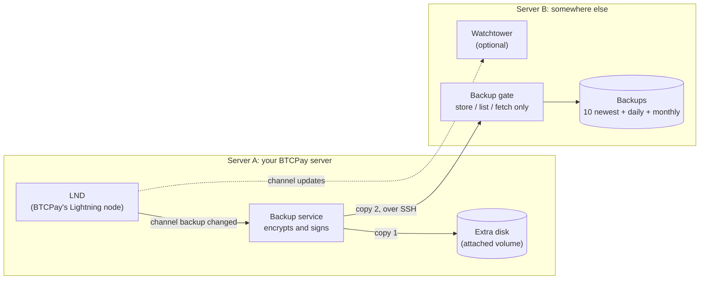
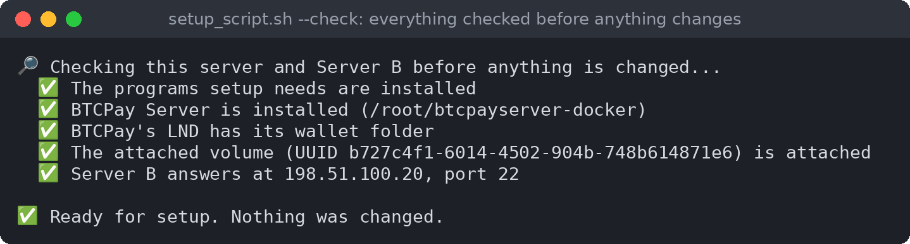

<p align="center">
  
</p>

<h1 align="center">btcpay-docker-lnd-manager</h1>

<p align="center">
  <b>Safe, automatic backups for the Lightning node of your BTCPay Server, and the tools to get it back.</b>
</p>

<p align="center">
  <b>English</b> · <a href="README.es.md">Español</a> · <a href="README.fr.md">Français</a> · <a href="README.de.md">Deutsch</a>
</p>

---

If your BTCPay Server's disk dies, the Lightning funds on it are only as safe as your last
backup of the node. btcpay-docker-lnd-manager makes those backups by itself, every time they
are needed, keeps them in two places, and walks you through getting your wallet and channels
back. It runs next to a BTCPay Server installed the usual way (btcpayserver-docker), with LND.

## What it does

- **Backs up LND by itself.** A service watches LND's channel backup. Each time it changes (a
  channel opens or closes), it makes a new backup. Once an hour it also checks for a change it
  may have missed. Nothing changed, no backup: the files LND rewrites by itself all the time don't
  count, so quiet days don't push your last good backups out.
- **Encrypted, signed, where you choose.** Every backup is encrypted and signed with your GPG
  key, then stored on an extra disk on the server, on a second server, on a private GitHub
  repository, or any of them: each one is on or off. Every copy is checked after it arrives.
- **The second server is protected from the first.** The first server's key can only store,
  list and fetch backups there: no shell, no deleting, no overwriting. A break-in on your BTCPay
  server can't wipe the backups somewhere else.
- **Gets your wallet back.** `lnd-wallet` restores the wallet from its seed, the channels from
  the newest good backup, or makes a new wallet. It always keeps a copy of the current wallet
  first, so every step can be undone.
- **A dashboard on each server.** It shows what's working, when the last backup reached each
  place, what's wrong, and what to do next. Type `/` for the commands: each one says what it
  does, and what it stops, before it runs.
- **Optional watchtower.** The second server can run Bitcoin Core and an LND watchtower that
  guards your channels while your node is offline. The blockchain can be copied over instead of
  downloaded for days, and new Bitcoin Core and LND releases are installed only after their
  signatures check out.
- **Four languages:** English, Spanish, French and German, for every screen, question and the
  backup log.

## How it works



- **Server A** is your BTCPay server. The backup service runs there as an account of its own,
  not as root. The scripts root runs are installed so that only root can change them.
- **The attached volume** is an extra disk on Server A, used only for backups.
- **Server B** is a second server you control, anywhere else. Its "gate" is the only thing
  Server A's key may run there: it stores, lists and fetches backups, and takes Server B's
  settings for you to use. It can't delete anything or run anything else. Server B keeps the 10 newest backups, one a day for 30 days,
  and one a month for 12 months, and rotates them itself.
- **To restore,** `lnd-wallet` looks on both places for the newest backup that decrypts, is
  signed with your key and matches its checksum, and tells you which one it found before
  anything changes.

## Screenshots

The backup dashboard on Server A:


Type `/` for the commands. Each one is explained before it runs:


Before anything changes, setup checks the server:



The checklist shows what's done and what's next:


The wallet tools:


The dashboard on Server B:


Setup asks for the language first. Then everything is in that language, the log too:


## Before you start

- **Server A**: Ubuntu or Debian (Raspberry Pi OS too), with BTCPay installed the usual way
  (btcpayserver-docker) and Lightning (LND) set up in BTCPay. You need an account with sudo.
- **An extra disk on Server A**: a block volume from your provider, or a second disk. Not the
  system disk. Setup shows how to prepare it if it is new.
- **Server B**: any Ubuntu or Debian server you can reach over SSH. For the watchtower:
  64-bit x86 or ARM, or 32-bit ARM.
- **Your LND seed, written down.** In BTCPay: Server Settings → Services → LND Seed Backup.

## Install on Server A

1. Get the project onto Server A, into your home folder:

   ```
   git clone https://github.com/juantrejo-coding/btcpay-docker-lnd-manager.git ~/btcpay-docker-lnd-manager
   ```

   Then check its signature (see [Check what you download](#check-what-you-download)): root
   runs these scripts.
2. Check that everything is ready. This changes nothing:

   ```
   cd ~/btcpay-docker-lnd-manager
   ./setup_script.sh --check
   ```

   ❌ lines say what to fix first. ⚠️ lines are things setup handles, or that can wait.
3. Run setup, as yourself (not with sudo):

   ```
   ./setup_script.sh
   ```

   It asks for the language first, runs the same check, then asks one thing at a time and saves
   your answers in `config`. It covers:
   - **The backup user**, a separate account that does the backup work. Setup makes it.
   - **Where the backups go**: the attached volume, Server B and GitHub, each on or off (see
     [Where the backups go](#where-the-backups-go)). The steps below are only for those that are on.
   - **The attached volume**. Choose the disk from the list; setup mounts it safely.
   - **Server B**: its address, SSH port and the user that will hold the backups. Setup then
     shows Server B's fingerprint. **Check it on Server B itself** (setup shows the command),
     so you know you're talking to the right server.
   - **The SSH key** Server A uses to reach Server B. Setup makes it.
   - **The GPG key** that encrypts the backups. Paste one you have, or let setup make one.
     **Save the private key somewhere safe, away from this server: without it nobody can open
     the backups.**
   - Confirming that your LND seed is written down.
   - **The backup service**, the last question. Answer `y`.

   The words you type to confirm (`yes`, `STOP BTCPAY`, `I WROTE IT DOWN` …) are English in
   every language: type them as shown.
4. Get Server A's key onto Server B. Setup offers two ways:
   1. The Server B user exists and you know its password: setup copies the key itself.
   2. Otherwise setup makes `serverb-user-setup.sh`. Copy it to Server B yourself and run it
      there with `sudo bash serverb-user-setup.sh`, then run `./setup_script.sh` on Server A
      again.

      Or, if you clone the project on Server B too: run `lnd-manager` → `/serverb send`, which
      can't reach Server B yet and shows `serverb.conf` instead. On Server B, in the clone, run
      `sudo ./serverb-setup.sh --paste`, paste it, and answer `yes` to step 1 only.

   Either way, setup then locks the key down so it can only reach the backups (the gate).
5. Open the dashboard:

   ```
   lnd-manager
   ```

   Until everything is set up, the top line says what to do next. Type `/checklist` to see
   every step.

## Daily use

`lnd-manager` shows whether the service runs, when the last backup reached each place, and any
problems. Type `/` for the list of commands. Each one explains what it does before it runs.

Backups are only made when LND's channel backup changes (a channel opens or closes, for example).
Days without a new backup are normal on a quiet node.

## Where the backups go

Each backup goes to every destination that is on. Turn them on and off in the dashboard:
`/destinations` shows them, `/destination volume`, `/destination serverb` and `/destination github`
turn one on or off. At least one stays on, and the dashboard warns while no copy leaves Server A.

| Destination | What it is | Can a broken-into Server A delete the copies there? |
|---|---|---|
| **The attached volume** | An extra disk on Server A. The quickest to restore from. | Yes: it is on Server A. |
| **Server B** | Your second server, through its backup gate. | No: the gate never deletes or overwrites. |
| **GitHub** | A private repository of yours. Free. | Yes: GitHub can't stop it on a free private repository. |

Each keeps the 10 newest backups, the first of each day for 30 days and of each month for 12
months, and the safety backups `lnd-wallet` makes. Turning one off keeps the copies already there,
and restoring still looks everywhere. A destination that fails is tried again every hour.

**GitHub**, step by step:
1. On github.com, make a new repository just for the backups, for example `lnd-backups`. It must
   be **private**, and empty. Not this project's repository.
2. Turn GitHub on (`/destination github`, or answer yes in setup), and type the repository as
   `owner/name`. Setup checks it isn't public.
3. Setup makes a **deploy key** for the backup user and shows it: an SSH key that reaches only that
   one repository. On GitHub, open the repository's **Settings → Deploy keys → Add deploy key**,
   paste it, and tick **Allow write access**. No GitHub password or account token goes on the
   server.
4. Setup checks the key can write, then the backup service sends each backup there.

The repository keeps only the current backups: each upload replaces its history, so old backups
are really gone and the repository stays small (GitHub asks that repositories stay under 1 GB).
The backups are encrypted with your GPG key, so GitHub can't read them; keep that key off GitHub.

## If you lose the wallet

```
sudo lnd-wallet restore      # the on-chain funds, from the seed
sudo lnd-wallet channels     # the funds and the channels
```

Or use `/wallet` in the dashboard. The script finds the newest good backup on the attached
volume or Server B, and keeps a safety copy of the current wallet before it changes anything.
Server B keeps up to 20 safety copies (50 GB); when it is full, delete old ones there.
Restoring channels asks each channel peer to close its channel, and your share comes back
on-chain. Never run a restored node while the old one still runs with the same seed.

## Optional: a watchtower on Server B

A watchtower keeps an eye on your channels while your node is offline.

1. In the dashboard: `/serverb send`. It sends Server B its settings (`serverb.conf`) through
   the backup gate, into the backup user's `~/serverb-setup`. Nothing runs there by itself.
   Choose how Server B gets the scripts:
   1. **git clone (recommended).** Only the settings come from Server A. On Server B, as your
      admin account:

      ```
      git clone https://github.com/juantrejo-coding/btcpay-docker-lnd-manager.git
      cd btcpay-docker-lnd-manager
      ```

      Check the signature ([Check what you download](#check-what-you-download)), then:

      ```
      sudo ./serverb-setup.sh <backup user>
      ```

      It reads `serverb.conf` as data (never runs it), shows every value, and makes the
      scripts from the clone you checked. Root on Server B then runs only code you checked,
      even if Server A was broken into.
   2. **Scripts from Server A.** For a Server B that can't reach GitHub. Server A also sends
      `serverb-install.sh`, all the scripts in one file. On Server B, copy it out of the backup
      user's folder first (root won't run it from there), and compare its sha256 with the one
      `/serverb send` showed:

      ```
      sudo -u <backup user> cat ~<backup user>/serverb-setup/serverb-install.sh > serverb-install.sh
      sha256sum serverb-install.sh
      sudo bash serverb-install.sh
      ```

      This is as safe as copying the scripts over by hand, and no safer: root on Server B runs
      what Server A made. If Server A was broken into, the sha256 it shows can be faked too.

   Either way it goes through the steps in order, asking before each: the backup user and
   gate, Bitcoin Core, the blockchain import, the watchtower, the dashboard. The scripts it ran
   stay in `/var/lib/serverb-setup/scripts`. A backup gate older than `/serverb send` refuses
   the settings: then use way 1 with `--paste` (it shows the settings to paste), and step 1
   updates the gate.
2. To save Server B days of syncing, copy the blockchain over from Server A: `/chain copy`
   (`/chain prune` first, if BTCPay's blockchain isn't pruned yet). It asks where the blockchain
   is pruned to Server B's size: on Server A, in a copy beside BTCPay's (BTCPay's own blockchain
   isn't changed, and about half as much is sent: the chainstate, some 12 GB, can't be pruned),
   or on Server B after the import. It checks first that both servers have room. The steps stop
   after Bitcoin Core until the copy is done; run the same command on Server B again to go on.
3. Back on Server A: `/tower add`, with the tower's address the watchtower step showed.

`/serverb scripts` still makes the scripts one by one, to copy to Server B yourself.

On Server B, log in as the dashboard's admin account and run `serverb-dashboard`. It has its
own `/checklist`, and says when a new release of Bitcoin Core, LND or these scripts is out (see
[Updating](#updating)).

## Keep these safe, offline

- **Your LND seed.** It brings back your funds.
- **The GPG private key.** It opens the backups.

## Check what you download

Every commit and release tag is signed with this GPG key:

```
Juan Trejo <juantrejo_coding@proton.me>
93F4 433D CE56 353B D7E6  9D42 CBFE 4123 CF41 21FA
```

A fingerprint printed next to the code proves nothing by itself: whoever could change the code
could change this page too. So get the key from two places and check that both show the
fingerprint above:

```
curl -fsSL https://github.com/juantrejo-coding.gpg | gpg --show-keys
gpg --keyserver hkps://keys.openpgp.org --recv-keys 93F4433DCE56353BD7E69D42CBFE4123CF4121FA
gpg --fingerprint 93F4433DCE56353BD7E69D42CBFE4123CF4121FA
```

Then, in the clone:

```
git tag -l                           # the releases
git verify-tag <newest tag>          # "Good signature from Juan Trejo", with the fingerprint above
git checkout <newest tag>
git log --show-signature -3          # each commit: "Good signature", the same fingerprint
```

Without a release tag yet, check the newest commit instead: `git verify-commit HEAD`. gpg may add
"This key is not certified with a trusted signature": that is normal for a key you haven't
signed yourself. What counts is "Good signature" and the fingerprint. Anything else (a BAD
signature, another fingerprint, no signature): don't run it.

You only do this by hand the first time. After that, the update commands below check every new
release the same way, against the key installed with the scripts.

## Updating

Nothing updates by itself. Both dashboards say when a new release is out; you start the update and
type `UPDATE`. Each update first downloads the release and checks its signature, then installs it
only when that is safe. If it isn't safe yet, it waits in the background and checks every 5
minutes, for up to 24 hours; after that the update is installed at the next boot, before the
services it touches start. The dashboard shows an update that is waiting.

**Server A** (`/update` in `lnd-manager`, or `sudo lnd-update`): these scripts, from the newest
signed release tag. Safe means no backup, no wallet operation and no `/chain` or `/tower`
operation is running. The backup service is reinstalled; LND and BTCPay keep running (BTCPay
updates them itself, with `btcpay-update.sh`). Your working folder is moved to the same release,
your `config` kept. If you changed other files there, it is left as it is and the update says so;
`install-scripts.sh` then refuses to put the older version back.

**Server B** (`serverb-dashboard`):
- `/update scripts`: these scripts, from the newest signed release, made with the settings
  `serverb-setup.sh` saved. The backup gate and the dashboard are updated; bitcoind and the
  watchtower keep running. Needs a Server B that can reach GitHub (way 1 above); otherwise use
  `/serverb send` again.
- `/update bitcoind` and `/update tower`: the newest Bitcoin Core or LND, checked like setup
  checks them. Updating restarts the watchtower, so it only happens while Server A's node can
  watch its own channels: Server A sends its state every 5 minutes through the gate (data only),
  and the update waits until that state is less than 10 minutes old, LND runs there, no payment
  is in flight and no channel is being opened or closed. A Server A that is off counts as not
  safe: that is when the tower is needed.

Later, these scripts may also come as a package from an APT repository; the same commands will then
use apt, which checks the package's signature.

## Changing settings

Edit `config` in your working folder, then run `sudo ./install-scripts.sh` there. The scripts
that run as root only use the copies it installs in `/usr/local/lib/btcpay-docker-lnd-manager`,
so nobody else can change them. After changing settings the backup service uses, also run
`/install` in the dashboard.

The language is `UI_LANGUAGE` in `config`: `en` (English), or the code of any translation in
`locale/` (`es`, `fr`, `de`).

## Support

If it keeps your node safe, please support its development. Bitcoin:

```
bc1qevxw36e4htzvlke3y0kqqz3qs0nfmreqhxkt73
```

This is also the donation address the license's payments go to (see [LICENSE](LICENSE), section 5).

## License

Free for personal and business use up to USD 1,000,000 in annual sales income; above that, or
inside another commercial node service or tool, a one-time payment in bitcoin. The full terms
are in [LICENSE](LICENSE), and a summary is under `/support` in the dashboard. No warranty: use
it at your own risk.
