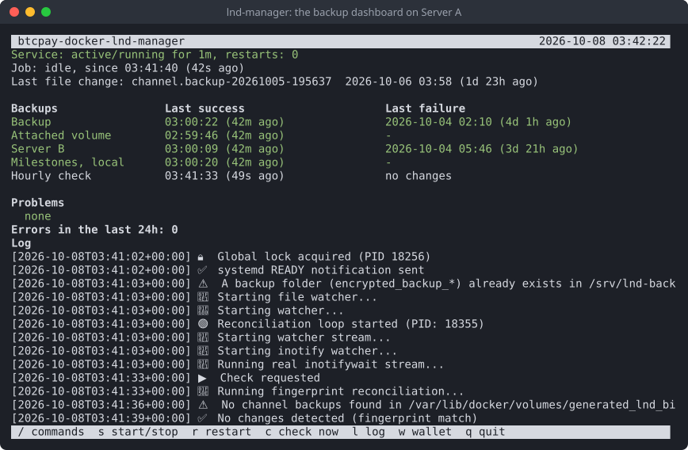
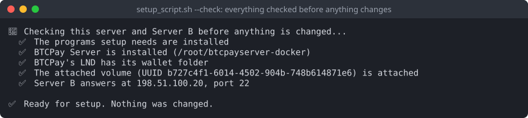

# btcpay-docker-lnd-manager

**English** · [Español](README.es.md) · [Français](README.fr.md) · [Deutsch](README.de.md)

Backups for the Lightning node (LND) of a BTCPay Server installed with btcpayserver-docker, plus
tools to restore the wallet, and an optional watchtower on a second server.

## How it works

There are three pieces:

- **Server A**: your BTCPay server, where LND runs.
- **The attached volume**: an extra disk on Server A, used only for backups.
- **Server B**: a second server somewhere else.

A backup service on Server A watches LND's channel backup. After every change it makes an
encrypted, signed copy with your GPG key. One copy goes to the attached volume and one to
Server B.

Server A's key can only store, list and fetch backups on Server B. It can't log in there or run
anything else, so a break-in on Server A can't delete what Server B holds.

## Screenshots

The backup dashboard on Server A, `lnd-manager`:



Type `/` for the commands; each one says what it does, and what it stops, before it runs:


| | |
|---|---|
|  |  |
|  |  |

In English, Spanish, French or German, chosen at the start of setup:

| | |
|---|---|
|  |  |

## Before you start

- **Server A**: Ubuntu or Debian, with BTCPay installed the usual way (btcpayserver-docker) and
  Lightning (LND) set up in BTCPay. You need an account with sudo.
- **An extra disk on Server A**: a block volume from your provider, or a second disk. Not the
  system disk. Setup shows how to prepare it if it is new.
- **Server B**: any Ubuntu or Debian server you can reach over SSH.
- **Your LND seed, written down.** In BTCPay: Server Settings → Services → LND Seed Backup.

## Install on Server A

1. Copy this folder to Server A, into your home folder: `~/btcpay-docker-lnd-manager`.
2. Check that everything is ready. This changes nothing:

   ```
   cd ~/btcpay-docker-lnd-manager
   ./setup_script.sh --check
   ```

   ❌ lines say what to fix first. ⚠️ lines are things setup handles, or that can wait.
3. Run setup, as yourself (not with sudo):

   ```
   ./setup_script.sh
   ```

   It asks for the language first, runs the same check, then asks one thing at a time and saves
   your answers in `config`. It covers:
   - **The backup user**, a separate account that does the backup work. Setup makes it.
   - **The attached volume**. Choose the disk from the list; setup mounts it safely.
   - **Server B**: its address, SSH port and the user that will hold the backups. Setup then
     shows Server B's fingerprint. **Check it on Server B itself** (setup shows the command),
     so you know you're talking to the right server.
   - **The SSH key** Server A uses to reach Server B. Setup makes it.
   - **The GPG key** that encrypts the backups. Paste one you have, or let setup make one.
     **Save the private key somewhere safe, away from this server: without it nobody can open
     the backups.**
   - Confirming that your LND seed is written down.
   - **The backup service**, the last question. Answer `y`.
4. Get Server A's key onto Server B. Setup offers two ways:
   1. The Server B user exists and you know its password: setup copies the key itself.
   2. Otherwise setup makes `serverb-user-setup.sh`. Copy it to Server B yourself and run it
      there with `sudo bash serverb-user-setup.sh`, then run `./setup_script.sh` on Server A
      again.

   Either way, setup then locks the key down so it can only reach the backups ("the gate").
5. Open the dashboard:

   ```
   lnd-manager
   ```

   Until everything is set up, the top line says what to do next. Type `/checklist` to see
   every step.

## Daily use

`lnd-manager` shows whether the service runs, when the last backup reached each place, and any
problems. Type `/` for the list of commands. Each one explains what it does before it runs.

Backups are only made when LND's channel backup changes (a channel opens or closes, for example).
Days without a new backup are normal on a quiet node.

## If you lose the wallet

```
sudo lnd-wallet restore      # the on-chain funds, from the seed
sudo lnd-wallet channels     # the funds and the channels
```

Or use `/wallet` in the dashboard. The script finds the newest good backup on the attached
volume or Server B, and keeps a safety copy of the current wallet before it changes anything.
Restoring channels asks each channel peer to close its channel, and your share comes back
on-chain.

## Optional: a watchtower on Server B

A watchtower keeps an eye on your channels while your node is offline.

1. In the dashboard: `/serverb scripts`. It makes the Server B scripts and lists the steps in
   order.
2. Copy the scripts to Server B yourself, from a computer you trust, and run them there with
   `sudo bash`: Bitcoin Core first, then the watchtower, then the Server B dashboard.
3. To save Server B days of syncing, copy the blockchain over from Server A: `/chain copy`
   (`/chain prune` first, if BTCPay's blockchain isn't pruned yet), then
   `serverb-import-chain.sh` on Server B.
4. Back on Server A: `/tower add`.

On Server B, log in as the dashboard's admin account and run `serverb-dashboard`. It has its
own `/checklist`. It also says when a new Bitcoin Core or LND release is out: `/update bitcoind`
or `/update tower` installs it, after checking its signatures the same way setup did. Nothing
updates by itself.

## Keep these safe, offline

- **Your LND seed.** It brings back your funds.
- **The GPG private key.** It opens the backups.

## Changing settings or updating

Edit `config` in your working folder, then run `sudo ./install-scripts.sh` there. The scripts
that run as root only use the copies it installs in `/usr/local/lib/btcpay-docker-lnd-manager`,
so nobody else can change them. After updating the scripts, also run `/install` in the
dashboard to update the backup service.

The language is `UI_LANGUAGE` in `config`: `en` (English), or the code of any translation in
`locale/` (`es` for Spanish).

## License

See `LICENSE`, or `/support` in the dashboard.
